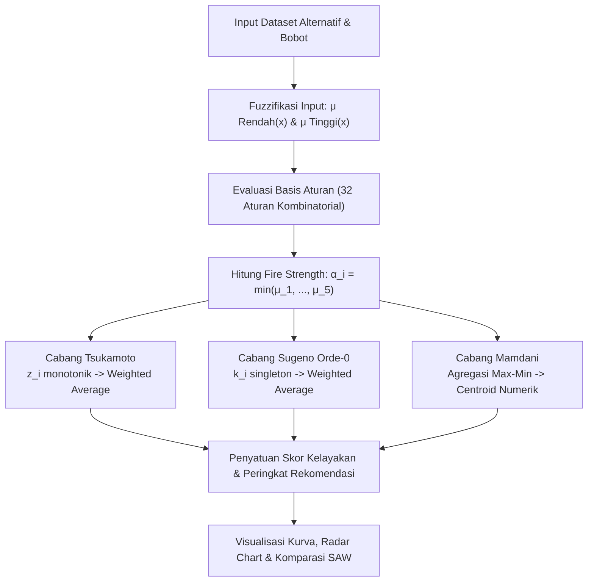

<p align="center">
  
</p>

<p align="center">
  <strong>Sistem Pendukung Keputusan Pemilihan Tempat Nongkrong Berbasis Multi-Model Fuzzy Inference</strong>
</p>

<p align="center">
  <a href="#fitur-utama"></a>
  <a href="#fitur-utama"></a>
  <a href="#fitur-utama"></a>
  <a href="#pengujian-unit"></a>
  <a href="#desain--antarmuka"></a>
  <a href="#lisensi"></a>
</p>

---

## Daftar Isi

- [Tentang Proyek](#tentang-proyek)
- [Fitur Utama](#fitur-utama)
- [Landasan Matematika & Metode Inferensi](#landasan-matematika--metode-inferensi)
- [Kriteria Keputusan & Dataset](#kriteria-keputusan--dataset)
- [Arsitektur Alur Sistem](#arsitektur-alur-sistem)
- [Struktur Repositori](#struktur-repositori)
- [Panduan Instalasi & Penggunaan](#panduan-instalasi--penggunaan)
- [Pengujian Unit](#pengujian-unit)
- [Sistem Desain & Identitas Brand](#sistem-desain--identitas-brand)
- [Lisensi](#lisensi)

---

## Tentang Proyek

**FuzzySpot** adalah aplikasi *Decision Support System* (SPK) berbasis web yang dirancang untuk memecahkan dilema pemilihan tempat nongkrong (kafe, *workspace*, atau tempat santai) secara objektif dan transparan.

Pemilihan tempat nongkrong sering kali melibatkan penilaian multi-kriteria yang bersifat linguistik, subjektif, dan tidak eksak (misalnya: suasana yang "nyaman", harga yang "terjangkau", atau fasilitas yang "memadai"). Logika Fuzzy (*Fuzzy Logic*) menjembatani nilai numerik riil ke dalam derajat keanggotaan linguistik (*fuzzification*), mengevaluasi kombinasi aturan penalaran (*rule inference*), dan menghasilkan nilai kelayakan tunggal yang terukur (*defuzzification*).

FuzzySpot mengimplementasikan dan membandingkan **3 paradigma penalaran fuzzy terpopuler** secara berdampingan:
1. **Model Tsukamoto**: Setiap aturan direpresentasikan dengan himpunan fuzzy monotonik; defuzzifikasi dilakukan melalui rata-rata terbobot (*weighted average*).
2. **Model Sugeno Orde-0**: Konsekuen aturan berupa konstanta skalar (*singleton output*); sangat efisien secara komputasi.
3. **Model Mamdani Centroid**: Menggunakan agregasi implikasi Max-Min dengan defuzzifikasi titik berat (*Center of Gravity / Centroid*) melalui integrasi analitik numerik.

---

## Fitur Utama

- **Multi-Model Inference Engine**: Menghitung skor kelayakan tempat nongkrong menggunakan metode Tsukamoto, Sugeno Orde-0, dan Mamdani secara simultan.
- **Pembangkitan Aturan Dinamis (32 Rules)**: Menghasilkan matriks kombinasi $2^5 = 32$ aturan penalaran berdasarkan ambang batas bobot kriteria.
- **Visualisasi Kurva Keanggotaan Reaktif**: Grafik interaktif Plotly untuk fungsi keanggotaan input (Rendah & Tinggi) serta fungsi output kelayakan (Tidak Layak & Layak) dengan penyesuaian parameter dinamis (*live curve adjustment*).
- **Benchmarking & Analisis Komparatif**: Membandingkan ranking ketiga model inferensi terhadap metode *Simple Additive Weighting* (SAW) standar.
- **Antarmuka Apple iPadOS Split-View**: Tata letak modern dengan panel navigasi tablet (*warm peach sidebar*), kartu status pastel, kontrol slider responsif, dan bebas dari emoji demi menjaga estetika profesional.

---

## Landasan Matematika & Metode Inferensi

### 1. Fungsi Keanggotaan Input Linear
Setiap kriteria $x \in [a, b]$ dipetakan ke dalam dua himpunan fuzzy linear:

- **Derajat Keanggotaan Rendah (Turun):**
  $$\mu_{\text{Rendah}}(x) = \begin{cases} 1, & x \le a \\ \frac{b - x}{b - a}, & a < x < b \\ 0, & x \ge b \end{cases}$$

- **Derajat Keanggotaan Tinggi (Naik):**
  $$\mu_{\text{Tinggi}}(x) = \begin{cases} 0, & x \le a \\ \frac{x - a}{b - a}, & a < x < b \\ 1, & x \ge b \end{cases}$$

*Default parameter: $a = 1.0$, $b = 5.0$, titik potong $\mu = 0.50$ berada pada $x = 3.0$.*

---

### 2. Evaluasi Aturan (Fire Strength $\alpha$)
Setiap aturan ke-$i$ dari 32 aturan mengevaluasi kondisi konjungtif menggunakan operator minimum (T-Norm Gödel):
$$\alpha_i = \min\left(\mu_{C1, i}(x_1), \mu_{C2, i}(x_2), \mu_{C3, i}(x_3), \mu_{C4, i}(x_4), \mu_{C5, i}(x_5)\right)$$

Konsekuen aturan ditentukan secara deterministik:
- Jika $\sum_{j \in \text{Tinggi}} w_j > 0.50 \implies \text{Konsekuen: Layak}$
- Selain itu $\implies \text{Konsekuen: Tidak Layak}$

---

### 3. Perbandingan Defuzzifikasi Model

| Parameter / Aspek | Tsukamoto | Sugeno Orde-0 | Mamdani Centroid |
| :--- | :--- | :--- | :--- |
| **Bentuk Konsekuen** | Monotonik Linear | Konstanta Singleton | Himpunan Fuzzy Kontinu |
| **Rumus Tidak Layak** | $z_i = 50 - (\alpha_i \times 50)$ | $k_{\text{Tidak Layak}} = 25.0$ | Segitiga/Trapesium $[0, 50]$ |
| **Rumus Layak** | $z_i = 50 + (\alpha_i \times 50)$ | $k_{\text{Layak}} = 75.0$ | Segitiga/Trapesium $[50, 100]$ |
| **Metode Defuzzifikasi** | Rata-rata Terbobot | Rata-rata Terbobot | Titik Berat (*Center of Gravity*) |
| **Formula Akhir** | $$z^* = \frac{\sum_{i=1}^{32} \alpha_i \cdot z_i}{\sum_{i=1}^{32} \alpha_i}$$ | $$z^* = \frac{\sum_{i=1}^{32} \alpha_i \cdot k_i}{\sum_{i=1}^{32} \alpha_i}$$ | $$z^* = \frac{\int_{0}^{100} z \cdot \mu_C(z) \, dz}{\int_{0}^{100} \mu_C(z) \, dz}$$ |

---

## Kriteria Keputusan & Dataset

### Definisi 5 Kriteria

| Kode | Nama Kriteria | Tipe | Rentang Nilai | Bobot ($w_j$) | Keterangan |
| :---: | :--- | :---: | :---: | :---: | :--- |
| **C1** | Harga | Benefit | 1.0 - 5.0 | 25% ($0.25$) | Keterjangkauan harga menu makanan & minuman |
| **C2** | Fasilitas | Benefit | 1.0 - 5.0 | 30% ($0.30$) | Ketersediaan Wi-Fi cepat, colokan, musholla, toilet |
| **C3** | Jarak | Benefit | 1.0 - 5.0 | 15% ($0.15$) | Aksesibilitas lokasi dan kemudahan parkir |
| **C4** | Kenyamanan | Benefit | 1.0 - 5.0 | 18% ($0.18$) | Suasana (*ambience*), tingkat kebisingan, estetika |
| **C5** | Jam Operasional | Benefit | 1.0 - 5.0 | 12% ($0.12$) | Durasi buka harian (misal: 24 jam / hingga larut) |

*Total bobot terdistribusi normal: $\sum w_j = 1.00$ (100%).*

### Dataset Alternatif Bawaan

| Alternatif | C1 (Harga) | C2 (Fasilitas) | C3 (Jarak) | C4 (Kenyamanan) | C5 (Jam Buka) |
| :--- | :---: | :---: | :---: | :---: | :---: |
| **Kalis Donut** | 3.0 | 5.0 | 4.0 | 5.0 | 2.0 |
| **Torte** | 4.0 | 3.0 | 3.0 | 4.0 | 5.0 |
| **Anindita** | 5.0 | 2.0 | 5.0 | 2.0 | 3.0 |
| **Cosan** | 3.0 | 3.0 | 4.0 | 4.0 | 4.0 |

---

## Arsitektur Alur Sistem



---

## Struktur Repositori

```text
c:/.../FuzzySpot/
├── assets/
│   └── logo/
│       ├── PANDUAN-LOGO-FUZZYSPOT.md        # Pedoman brand identity & warna
│       ├── fuzzyspot-horizontal.svg         # Master logo vektor horizontal
│       ├── fuzzyspot-badge-64.svg           # Simbol aplikasi badge 64x64
│       ├── fuzzyspot-symbol.svg             # Simbol kurva silang
│       ├── png/                             # Ekspor raster resolusi tinggi
│       └── web/                             # Favicon & manifest browser
├── tests/
│   └── test_fuzzy.py                        # 8 Unit test validasi matematika
├── .streamlit/
│   └── config.toml                          # Konfigurasi server & tema
├── app.py                                   # Aplikasi antarmuka dashboard utama
├── membership.py                            # Definisi fungsi keanggotaan linear
├── tsukamoto.py                             # Implementasi inferensi model Tsukamoto
├── sugeno.py                                # Implementasi inferensi model Sugeno Orde-0
├── mamdani.py                               # Implementasi inferensi model Mamdani
├── rules.py                                 # Mesin pembangkit 32 aturan penalaran
├── compare.py                               # Modul perbandingan model & benchmarking SAW
├── style.css                                # Desain tema iPadOS Split-View & Stitch
├── requirements.txt                         # Dependensi pustaka Python
└── README.md                                # Dokumentasi utama repositori
```

---

## Panduan Instalasi & Penggunaan

### Prasyarat
- Python 3.10 atau versi lebih baru (direkomendasikan Python 3.12).
- Peramban web modern (Google Chrome, Safari, Firefox, atau Microsoft Edge).

### Langkah Menjalankan

1. **Kloning Repositori:**
   ```bash
   git clone https://github.com/firnassw/FuzzySpot.git
   cd FuzzySpot
   ```

2. **Buat & Aktifkan Lingkungan Virtual (Opsional namun Disarankan):**
   ```bash
   # Windows (PowerShell)
   python -m venv venv
   .\venv\Scripts\Activate.ps1

   # macOS / Linux
   python3 -m venv venv
   source venv/bin/activate
   ```

3. **Pasang Dependensi:**
   ```bash
   pip install -r requirements.txt
   ```

4. **Jalankan Aplikasi:**
   ```bash
   streamlit run app.py
   ```

Aplikasi akan otomatis terbuka pada peramban di alamat `http://localhost:8501`.

---

## Pengujian Unit

FuzzySpot dilengkapi rangkaian pengujian unit (*test suite*) otomatis berbasis `pytest` untuk memverifikasi keabsahan matematis dari setiap fungsi keanggotaan, evaluasi aturan, dan mesin defuzzifikasi.

Jalankan test suite dengan perintah:
```bash
pytest tests/test_fuzzy.py -v
```

### Cakupan Pengujian (8 Uji Validasi):
- `test_membership_boundaries`: Memverifikasi batas kritis fungsi keanggotaan pada $x = 1.0$, $x = 3.0$, dan $x = 5.0$.
- `test_membership_symmetry`: Memvalidasi sifat partisi fuzzy $\mu_{\text{Rendah}}(x) + \mu_{\text{Tinggi}}(x) = 1.0$.
- `test_rules_generation_count`: Memastikan tepat 32 aturan dihasilkan (16 Layak, 16 Tidak Layak).
- `test_tsukamoto_monotonicity`: Memverifikasi skor output Tsukamoto monoton naik terhadap input yang lebih baik.
- `test_sugeno_monotonicity`: Memverifikasi sifat output Sugeno berada dalam interval $[25.0, 75.0]$.
- `test_mamdani_output_range`: Memverifikasi hasil integrasi centroid Mamdani berada dalam interval $[0.0, 100.0]$.
- `test_all_methods_consistent_ranking`: Menguji konsistensi peringkat tempat nongkrong teratas pada dataset default.
- `test_extreme_inputs`: Menguji stabilitas model pada nilai ekstrem ($x = 1.0$ dan $x = 5.0$).

---

## Sistem Desain & Identitas Brand

FuzzySpot menerapkan prinsip desain *Apple iPadOS Split-View & Google Stitch*:

- **Filosofi Logo**: Dua fungsi keanggotaan fuzzy linear (Low menurun, High meningkat) saling bersilangan. Titik temu di tengah (*node*) adalah "spot" di mana keputusan inferensi ditentukan.
- **Palet Warna Utama**:
  - `Royal Indigo` (`#3B28CC`): Warna primer, aksen utama navigasi, dan kurva $\mu$ Rendah.
  - `Warm Coral` (`#E07A5F`): Aksen sekunder dan kurva $\mu$ Tinggi.
  - `Teal Emerald` (`#10B981`): Status layak dan aksen model Sugeno.
  - `Deep Indigo Black` (`#1E1B2E`): Warna tipografi teks utama.
  - `Warm Pastel Peach` (`#FFF1EB`): Latar belakang navigation rail kiri.
  - `Border Peach` (`#F3D5C5`): Garis pembatas kartu dan komponen interaktif.
- **Strict Clean UI**: Seluruh antarmuka dirancang bebas dari emoji (*zero emoji policy*), mengandalkan ikonografi SVG dan glif tipografi rapi.

---

## Lisensi

Proyek ini didistribusikan di bawah lisensi terbuka [MIT License](LICENSE). Silakan gunakan, pelajari, dan kembangkan sesuai kebutuhan akademis atau profesional Anda.

Dibuat oleh **[Wahid Firnas](https://github.com/firnassw)**.
